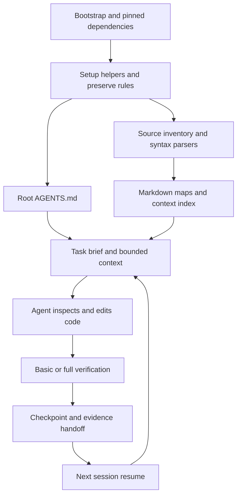

# Architecture

AgentMaploom is a local Node.js 24+ CLI, with Windows bootstrap. Source development uses native TypeScript; npm installation runs precompiled JavaScript so Node does not need to strip types inside node_modules. It provides project preparation and context tools around the user's chosen coding agent.

## Modules

| Area | Source |
| --- | --- |
| CLI and compact output | `src/cli.ts`, `src/axi.ts` |
| Profiles/config | `src/config.ts`, `src/profile.ts`, `src/types.ts` |
| Setup/attachment/helper pins | `src/init.ts`, `src/setup.ts`, `src/native-tool.ts` |
| Source maps/context | `src/scan.ts`, `src/ts-source.ts`, `src/map.ts`, `src/doc-index.ts`, `src/context.ts` |
| Task/memory/resume/handoff | `src/task.ts`, `src/state.ts`, `src/io.ts` |
| Unity and test execution | `src/project.ts`, `src/mcp.ts`, `src/batch-project.ts`, `src/verify.ts`, `src/process.ts` |
| Native full-mode gate | `src/no-mistakes.ts` |
| Local HTML review | `src/review.ts` |
| Graft isolation adapter | `src/adapters/` |
| Packaging | `scripts/release-files.ts`, `scripts/package-release.ts`, `scripts/smoke-package.ts` |

## Data and compatibility

The workspace name remains `.agentkit/` for compatibility with the local prototype. Generated project entry points are `agentkit.mjs` and `agentkit.ps1`; public toolkit CLI is `agent-maploom`. The legacy root `agentkit.ps1` entry point still works. Generated AGENTS markers retain the existing schema for safe repeated attachment. VS Code task migration recognizes the legacy AgentKit labels.

Maps are static relationships with recorded certainty, not a complete runtime call graph. Core retrieval uses deterministic lexical/symbol scoring and limits. Graft is an additional graph cache, not the authoritative schema for the core map. Document status markers help distinguish current intent from old proposals; retrieved content is data, not new instructions.

Commands use explicit executable/arguments; scanning does not run package scripts or embedded document commands. Atomic writes, workspace locks and a journal support recovery. Credentials are redacted from tool output; none belong in durable task memory. Native gate work uses a separate project-scoped home.

Publication uses an explicit source allowlist. Local research, game pilot data, generated maps/memory, caches and credentials are outside the public repository and release assets.
